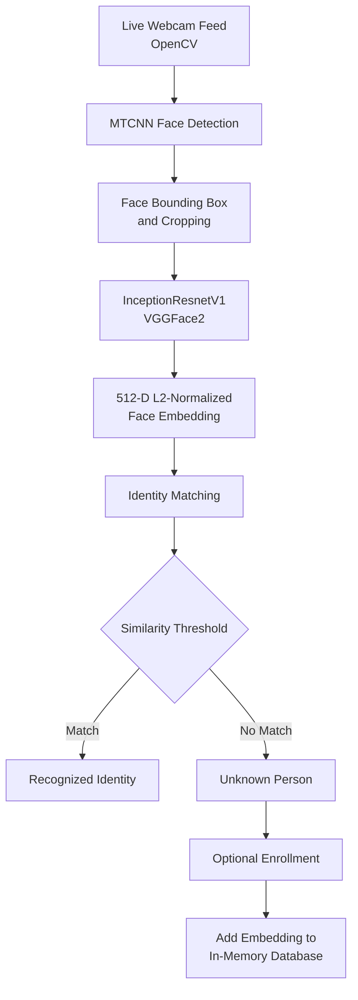

# Real-Time Face Detection & Recognition System

A Jupyter Notebook project that combines **PyTorch**, **MTCNN**, **InceptionResnetV1**, and **OpenCV** to detect faces, recognize registered people, and enroll new identities through a live webcam feed.

The notebook demonstrates an end-to-end computer vision pipeline, from image preprocessing and face localization to feature extraction, identity matching, performance profiling, and recognition-log export.

## Overview

The system processes a live camera frame through the following pipeline:



## Features

- **Face detection:** Uses MTCNN's three-stage cascade (P-Net, R-Net, and O-Net) to locate faces and facial landmarks.
- **Face cropping:** Applies a configurable margin, checks image boundaries, and produces face crops at `160 × 160`.
- **Deep feature extraction:** Uses `InceptionResnetV1`, pretrained on VGGFace2, to generate 512-dimensional face embeddings.
- **Identity matching:** Compares normalized embeddings using cosine similarity or Euclidean distance.
- **Live webcam recognition:** Displays face bounding boxes, identity labels, confidence scores, FPS, and latency.
- **Interactive enrollment:** Register a new person from the webcam without restarting the notebook.
- **Recognition logs:** Records timestamps, identities, match status, metric, and score; exports the log to CSV.
- **Performance profiling:** Measures detection, embedding, and matching latency, as well as model parameter count and memory footprint.
- **Hardware-aware execution:** Selects CUDA, Apple Silicon MPS, or CPU automatically.

## Technology Stack

| Technology | Purpose |
|---|---|
| Python | Main programming language |
| PyTorch | Deep learning inference |
| Torchvision | Dataset loading and image transformations |
| facenet-pytorch | MTCNN and InceptionResnetV1 |
| OpenCV | Webcam access and live display |
| NumPy | Numerical operations and embedding comparison |
| Pandas | Recognition-log management and CSV export |
| Matplotlib | Image and performance visualizations |
| Pillow | Image loading and processing |
| CelebA | Sample face dataset for preprocessing and demonstrations |
| VGGFace2 | Pretraining dataset used by the recognition backbone |

## Project Structure

```text
.
├── computervision.ipynb   # Main implementation and demonstrations
└── README.md
```

## Getting Started

### 1. Requirements

- Python environment with compatible PyTorch and Torchvision versions
- Jupyter Notebook or JupyterLab
- Webcam for live recognition and enrollment
- A desktop environment that supports OpenCV windows
- Optional: NVIDIA GPU with CUDA or an Apple Silicon Mac with MPS support

### 2. Install Dependencies

Install PyTorch and Torchvision using the installation command appropriate for your operating system and hardware. Then install the remaining packages:

```bash
pip install facenet-pytorch opencv-python numpy pandas matplotlib pillow jupyter
```

If PyTorch and Torchvision are not installed yet, install them first using the official PyTorch installation instructions.

### 3. Set Up the CelebA Dataset

The notebook attempts to load CelebA using `torchvision.datasets.CelebA` from:

```text
./data
```

If that dataset is not available, it checks a local extracted image directory. The notebook currently uses this example path:

```text
/Users/ahmed/Downloads/img_align_celeba
```

Update the `local_download_path` argument in `load_celeba_dataset()` to the location of your extracted CelebA images.

The local fallback reads up to **5,000** `.jpg`, `.jpeg`, or `.png` images. If neither dataset location is available, the notebook creates a small synthetic image dataset for demonstration purposes. Synthetic images are not suitable for evaluating real face recognition.

> The CelebA dataset is used for preprocessing, augmentation, and demonstrations. The face embedding model is loaded with pretrained VGGFace2 weights; the notebook does not fine-tune the model.

### 4. Run the Notebook

Clone or download this repository, open a terminal in the project directory, and start Jupyter:

```bash
jupyter notebook
```

Open `computervision.ipynb` and execute the cells **from top to bottom**.

The notebook initializes the detector and embedding model, runs the recognition interface, benchmarks the pipeline, and exports the recognition log.

> **Webcam note:** Run the notebook locally in a desktop session if you want to use the OpenCV webcam window. Allow camera access when your operating system asks for permission. The default camera index is `0`; change `camera_index` in the launcher if your webcam uses a different index.

## How It Works

### 1. Data Preprocessing

The CelebA preprocessing pipeline includes:

- Resize to `224 × 224`
- Random horizontal flipping
- Color jitter for brightness, contrast, and saturation
- Small random rotations
- Tensor conversion
- Channel normalization using ImageNet mean and standard deviation

A separate deterministic transformation is defined for inference and verification.

### 2. Face Detection — MTCNN

MTCNN detects faces using three cascaded networks:

1. **P-Net:** Proposes candidate face regions.
2. **R-Net:** Refines candidate bounding boxes and removes false detections.
3. **O-Net:** Produces final bounding boxes and five facial landmarks.

The notebook's detector uses a confidence threshold of `0.90` and a default crop margin of `20` pixels. Detected faces are cropped and resized to `160 × 160` before feature extraction.

### 3. Feature Extraction — InceptionResnetV1

The recognition backbone is initialized with:

```python
InceptionResnetV1(pretrained="vggface2", classify=False)
```

The model is used as a frozen feature extractor. Each face produces a **512-dimensional embedding**, which is L2-normalized before matching.

### 4. Identity Matching

The recognition database is an in-memory Python dictionary containing one or more embeddings per registered name.

Two distance metrics are supported:

| Metric | Default threshold | Match condition |
|---|---:|---|
| Cosine similarity | `0.55` | Similarity ≥ threshold |
| Euclidean distance | `0.95` | Distance ≤ threshold |

Higher cosine similarity indicates more similar embeddings. Lower Euclidean distance indicates more similar embeddings.

The default matching metric is cosine similarity. Thresholds and the selected metric can be changed when initializing `FaceRecognitionSystem`.

### 5. Live Recognition and Enrollment

When the webcam interface is running:

| Key | Action |
|---|---|
| `a` | Start enrollment for a detected face |
| `Enter` | Save the entered person's name |
| `Esc` | Cancel enrollment |
| `Backspace` | Edit the entered name |
| `q` | Exit and release the webcam |

Recognized faces are displayed with identity labels and confidence scores. Faces that do not pass the selected threshold are labeled **Unknown**.

## Performance Results

The notebook includes a benchmark of face detection, feature extraction, and identity matching. The recorded run used **Apple Silicon**, with InceptionResnetV1 running on **MPS** and MTCNN running on **CPU**.

| Pipeline stage | Average latency | Standard deviation |
|---|---:|---:|
| MTCNN face detection | 19.47 ms | ± 2.08 ms |
| InceptionResnetV1 feature extraction | 20.58 ms | ± 0.90 ms |
| Face database matching | 0.05 ms | ± 0.01 ms |
| **End-to-end frame latency** | **40.11 ms** | — |

**Recorded throughput:** approximately **24.9 FPS**.

The notebook also reports:

- InceptionResnetV1 parameters: `27,910,327`
- Model parameter memory footprint: approximately `106.47 MB` (FP32)

These are results from the recorded notebook run, not guaranteed performance figures. Actual latency and FPS depend on the processor, GPU, camera, image conditions, and number of registered embeddings.

## Recognition Logs

Each recognition event records:

- Timestamp
- Identity (`Unknown` when no match is found)
- Recognition status
- Matching metric
- Similarity or confidence score

The final notebook section exports the activity log to:

```text
face_recognition_log.csv
```

The CSV is written to the notebook's current working directory.

## Hardware Acceleration

The notebook automatically selects the available compute device:

1. **CUDA:** Uses an available NVIDIA GPU.
2. **MPS:** Uses Apple Silicon GPU acceleration for InceptionResnetV1 and CPU for MTCNN.
3. **CPU:** Uses the host CPU when no supported GPU backend is available.

The MTCNN CPU fallback on Apple Silicon is intentional in this notebook to avoid an interpolation issue encountered with MPS.

## Limitations and Future Improvements

This repository is a computer vision learning and demonstration project. It should not be treated as a production-ready biometric access-control or security system.

Current implementation limitations:

- Registered identity embeddings are kept in memory and are not persisted between notebook sessions.
- The notebook does not implement liveness detection or anti-spoofing.
- Recognition thresholds are configurable demonstration values and require validation on representative data before practical use.
- The matching database uses a simple in-memory search and may become inefficient as the number of identities grows.
- Camera availability and OpenCV GUI support depend on the machine running the notebook.

Potential next steps:

- Add liveness detection and anti-spoofing checks.
- Add secure, persistent storage for registered embeddings.
- Evaluate false-acceptance and false-rejection rates on an appropriate test dataset.
- Use FAISS for scalable similarity search with large identity collections.
- Explore ONNX or TensorRT deployment and optimized inference.
- Add access controls, encryption, retention policies, and consent workflows.

## Privacy and Responsible Use

Face embeddings are biometric data and should be handled carefully. Obtain appropriate consent before collecting or processing anyone's face data, follow applicable laws and institutional policies, and restrict access to stored embeddings and recognition logs.

The current notebook keeps identity embeddings in memory and exports recognition events to CSV. It does not provide a complete biometric-data security or privacy-management system.

## Acknowledgements

- [PyTorch](https://pytorch.org/)
- [Torchvision](https://pytorch.org/vision/stable/index.html)
- [facenet-pytorch](https://github.com/timesler/facenet-pytorch)
- [OpenCV](https://opencv.org/)
- CelebA dataset
- VGGFace2 pretrained model weights

---

**Project:** Real-Time Face Detection & Recognition System  
**Main file:** `computervision.ipynb`
